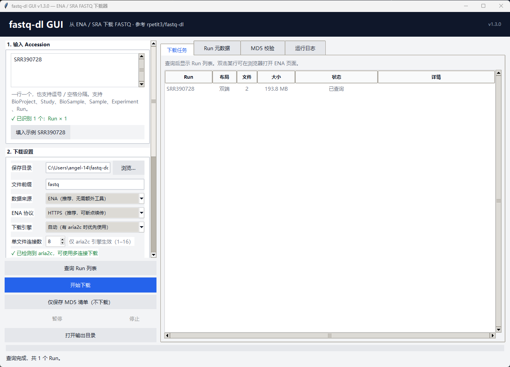

# fastq-dl GUI

参考 [rpetit3/fastq-dl](https://github.com/rpetit3/fastq-dl) 做的 **ENA / SRA FASTQ 图形下载器**。
输入 BioProject / Study / BioSample / Sample / Experiment / Run accession，查询出对应的所有 Run，
然后批量下载 FASTQ；需要时可以按 Experiment 或 Sample 合并多个 Run。



## 特点

| 功能 | 说明 |
| --- | --- |
| 独立桌面程序 | 纯 Python + Tkinter，不需要浏览器、不需要命令行 |
| 完整 accession 支持 | PRJEB/PRJNA/PRJDB、ERP/DRP/SRP、SAMD/SAME/SAMN、ERS/DRS/SRS、ERX/DRX/SRX、ERR/DRR/SRR |
| ENA 元数据查询 | 先查询再下载，界面里能看到 Run、布局、文件数、大小、物种等信息 |
| ENA 直连下载 | 直接用 `requests` 下载，不依赖 `wget`；HTTPS 默认、FTP 可选 |
| aria2c 多连接 | 可选下载引擎，单个文件最多 16 个连接并行，跨境下载通常明显更快 |
| 实时进度和速度 | 每个 Run 的状态列显示百分比和实时速度；双端时详情列分别显示 R1/R2 进度 |
| 断点续传 | 下载中的文件保存为 `.part`，中断后再次下载会从断点继续（HTTPS） |
| MD5 校验 | 使用 ENA 返回的 `fastq_md5` 校验；已有文件也会先校验再跳过 |
| MD5 清单 | 下载前自动保存 `<prefix>-md5.tsv`（Run、文件、大小、MD5、URL），可单独导出 |
| 独立 MD5 校验 | 「MD5 校验」标签页可脱离下载流程，直接校验清单和本地文件，并生成检查报告 |
| 并发下载 | 多个文件并行（1–8），每个文件还可再开多个连接（aria2c） |
| 失败重试 | 指数退避重试，次数和间隔可调 |
| 暂停 / 继续 / 停止 | 传输中按块响应，已下载部分保留 |
| Run 合并 | 可选按 Experiment 或 Sample 合并，输出 `_R1.fastq.gz` / `_R2.fastq.gz` |
| 仅元数据 | 勾选后只导出 `-run-info.tsv`，不下载 FASTQ |
| SRA 通道（可选） | 检测到 `sracha` 时可通过 SRA 下载，失败自动回退 ENA |
| 输出元数据 | 自动生成 `-run-info.tsv`；合并时生成 `-run-mergers.tsv` |
| 参数记忆 | 保存到同目录 `fastq_dl_gui.json`，下次自动带出 |
| 其他 | 双击 Run 打开 ENA 页面、导出元数据 TSV、保存日志、打开输出目录 |

## 与 fastq-dl 的对应关系

这个项目不是把 fastq-dl 包一层命令行，而是用 Python 重新实现了它最常用的流程：

| fastq-dl | 本工具 |
| --- | --- |
| `--accession` | 左侧输入框，支持一行多个 |
| `--provider ena/sra` | 「数据来源」下拉框 |
| `--protocol ftp/https` | 「ENA 协议」下拉框 |
| `--outdir` / `--prefix` | 「保存目录」/「文件前缀」 |
| `--max-attempts` / `--sleep` | 「重试次数」/「重试间隔」 |
| `--force` / `--ignore` | 「覆盖已存在的文件」/「跳过 MD5 校验」 |
| `--only-download-metadata` | 「仅获取元数据」 |
| `--group-by-experiment` / `--group-by-sample` | 「Run 合并方式」 |
| `--only-provider` | 「仅使用选定来源，不自动回退」 |
| `--sra-lite` / `--skip-compression` / `--gzip-level` | 「SRA 选项」 |
| `-run-info.tsv` / `-run-mergers.tsv` | 自动生成，命名规则一致 |

和 fastq-dl 的差异：

- 元数据统一从 **ENA Portal API** 查询，不依赖 `pysradb`。SRA 模式只改变下载通道；
  如果某个 Run 还没有同步到 ENA，本工具可能查不到它。
- SRA 下载依赖 [`sracha`](https://github.com/rnabioco/sracha)。没有安装时会自动回退到 ENA。
- 不需要 `wget`，ENA 下载由 `requests` 完成，并额外支持 `.part` 断点续传和并发。
- 额外提供 **aria2c 多连接引擎**（fastq-dl 没有对应参数），用于提升跨境单文件下载速度。
- 没有实现 Aspera 通道。

## 安装和运行

需要 Python 3.9+（建议 3.10+）。

```bash
pip install -r requirements.txt
python fastq_dl_gui.py
```

Windows 下也可以直接双击 `run.bat`（有 `pythonw` 时不显示控制台窗口）。

### 安装 aria2（可选，推荐）

aria2 是独立的下载程序，不装也能用（内置 `requests` 引擎），装上后可以开启多连接加速：

```bash
# conda / mamba（跨平台，推荐）
conda install -c conda-forge aria2

# Windows: scoop / winget / chocolatey
scoop install aria2
winget install aria2.aria2

# macOS
brew install aria2

# Ubuntu / Debian
sudo apt install aria2
```

安装后在终端执行 `aria2c --version` 能输出版本号即可。也可以把 `aria2c.exe`
放到本程序目录或 `bin\` 子目录下，程序会优先使用它（便携版就是这样内置的）。

### 下载引擎怎么选

| 引擎 | 特点 | 适用场景 |
| --- | --- | --- |
| 自动（默认） | 检测到 aria2c 就用 aria2c，否则用内置引擎 | 大多数情况 |
| 内置 requests | 单连接，逐块写入，兼容性最好；支持代理环境变量 | 调试、服务器限制多连接时 |
| aria2c 多连接 | 单文件多连接并行，支持更激进的重试与续传 | 大文件、跨境链路慢 |

「单文件连接数」只在 aria2c 引擎下生效（1–16，默认 8）。实际速度还受 ENA 单 IP
连接数限制影响，常见设置是 4–8；如果出现大量 429/连接重置，先降回 2–4。

程序按以下顺序查找 aria2c：程序目录 / `bin\` → PyPI `aria2` 包内的真实二进制 → `PATH`。
便携版已内置 `aria2c.exe`；通过 `pip install aria2` 安装时，程序会直接使用包内的真实二进制，
避免 PATH 里的启动器无法转发进度输出。

## 使用步骤

1. 在「输入 Accession」里填入 accession，一行一个，也可以逗号/空格分隔。
2. 点「查询 Run 列表」，确认查到的 Run 数量、布局和大小。
3. 选择保存目录，按需修改文件前缀、下载引擎、并发数、重试次数。
4. 点「开始下载」。状态列会实时显示百分比和下载速度（如 `下载中 45.2% · 8.3 MB/s`），
   详情列显示当前文件名；双端 Run 并行下载时，详情列会分别显示 `R1 45% · R2 62%`。
   开始下载前会先保存 `<prefix>-md5.tsv`，记录每个 FASTQ 的远程 MD5。
5. 下载结束后会自动写入 `<prefix>-run-info.tsv`。
6. 需要单独校验时，打开「MD5 校验」标签页，选择清单和文件所在目录，点「开始校验」。

如果只想保存 MD5、不下载 FASTQ，可以点左侧的「仅保存 MD5 清单（不下载）」；
也可以先查询 Run，再在「Run 元数据」页点「保存 MD5 清单」导出到任意位置。

支持的类型和示例：

| 类型 | 前缀 | 示例 |
| --- | --- | --- |
| BioProject | PRJEB / PRJNA / PRJDB | PRJNA480016 |
| Study | ERP / DRP / SRP | SRP020237 |
| BioSample | SAMD / SAME / SAMN | SAMN00630374 |
| Sample | ERS / DRS / SRS | SRS212581 |
| Experiment | ERX / DRX / SRX | SRX079566 |
| Run | ERR / DRR / SRR | SRR390728 |

输入 `PRJNA480016` 会下载该 BioProject 下所有 Run；输入 `SRR390728` 只下载这一个 Run。

## 输出文件

```
<保存目录>/
├── SRR390728_1.fastq.gz
├── SRR390728_2.fastq.gz
├── fastq-run-info.tsv          # 本次所有 Run 的元数据（含失败原因 error 列）
├── fastq-md5.tsv               # 下载前保存的远程 MD5 清单
├── fastq-md5-check.tsv         # 仅在执行「MD5 校验」时生成
└── fastq-run-mergers.tsv       # 仅在启用合并时生成
```

`fastq-md5.tsv` 的列：

| 列 | 说明 |
| --- | --- |
| `run_accession` | Run accession |
| `role` | `r1` / `r2` |
| `file` | 文件名（与下载到本地的文件名一致） |
| `size` | 字节数 |
| `md5` | ENA 提供的远程 MD5 |
| `url` | 完整下载地址（HTTPS 或 FTP） |

`fastq-md5-check.tsv` 会额外记录 `expected_md5`、`actual_md5`、`status` 和 `message`，
`status` 可能是 `通过`、`不匹配`、`缺失`、`无 MD5` 或 `读取失败`。

启用合并后，源 FASTQ 会被删除，并生成：

- 双端：`<Experiment 或 Sample>_R1.fastq.gz`、`_R2.fastq.gz`
- 单端：`<Experiment 或 Sample>.fastq.gz`

> 合并会删除源文件，这是为了和 fastq-dl 的行为一致。第一次使用时建议先不合并，
> 确认结果后再对目标 accession 启用。

## MD5 清单与独立校验

程序在真正下载 FASTQ 之前，会先查询 ENA 元数据并把远程 MD5 写成 `<prefix>-md5.tsv`。
这个文件不依赖下载结果，可以单独保存、复制到其他电脑，之后配合「MD5 校验」使用。

### 只保存 MD5（不下载）

- 左侧「仅保存 MD5 清单（不下载）」：查询 accession，只写 `<prefix>-md5.tsv`，不下载任何 FASTQ。
- 「Run 元数据」页的「保存 MD5 清单」：把当前查询到的 Run 导出为指定路径的清单。

### 独立校验

1. 打开「MD5 校验」标签页；
2. 选择 `-md5.tsv` 清单；
3. 数据目录留空表示使用清单所在目录，也可以指定 FASTQ 所在目录；
4. 点「开始校验」。

校验结果会逐文件显示期望 MD5、实际 MD5 和状态，并写出 `<prefix>-md5-check.tsv`。
校验过程有独立进度条和速度显示，可随时停止。

> `fastq-md5.tsv` 记录的是 ENA FASTQ 的 MD5。SRA 模式（`sracha`）重新压缩后的文件
> 可能与 ENA 原始 MD5 不同，此时请以 ENA 模式下载的文件为准，或关闭 SRA 通道后再校验。

## 一些实现细节

- **文件选择**：双端 Run 只保留 `*_1.fastq.gz` / `*_2.fastq.gz`；ENA 偶尔会给 Run 附带
  第三个文件，会按 fastq-dl 的规则跳过。
- **断点续传**：下载时先写 `文件名.part`，完成后改名为正式文件。内置引擎请求带 `Range`，
  服务器不支持时自动从头下；FTP 模式不支持 Range，会重新开始。
- **aria2c 续传**：aria2 会把分块状态保存在 `文件名.part.aria2` 控制文件里，中断后再次下载会
  从控制文件继续；程序还会额外写一个 `文件名.part.aria2tmp` 标记，用来判断 `.part` 是否可信：
  - 有 `.aria2`：按多连接续传；
  - 没有 `.aria2` 但 `.part` 来自内置引擎（连续前缀）：只用 **单连接** 续传，避免写坏文件；
  - 只有标记没有控制文件（前一次 aria2 被强制结束）：丢弃 `.part` 重新下载，保证正确性。
- **MD5**：下载前先把 ENA 返回的 `fastq_md5` 保存为 `<prefix>-md5.tsv`，下载完成后整文件计算一次
  MD5；已有文件在跳过前也会校验。大文件校验会花一些时间，不想等可以勾选「跳过 MD5 校验」。
- **独立 MD5 校验**：`Md5Verifier` 只读取清单和本地文件，不依赖下载引擎；按 4 MB 分块计算 MD5，
  实时报告文件数、字节进度和速度，结果写入 `<prefix>-md5-check.tsv`。
- **进度和速度**：总进度按 ENA 返回的 `fastq_bytes` 计算；如果某个文件没有大小信息，就用
  HTTP `Content-Length` 补上。状态列显示该 Run 的百分比和实时速度，详情列显示单文件进度。
  - 内置引擎按实际读取的字节数估算速度；
  - aria2c 引擎通过本机 JSON-RPC 读取 `completedLength` / `downloadSpeed`，精确到每个文件，
    不再依赖控制台输出（管道下 aria2 的摘要会被整块缓冲，无法实时刷新）；
  - 多连接时 `.part` 会提前被扩展到完整大小，所以不能直接看文件大小判断进度。
- **暂停 / 停止**：内置引擎在当前分块写完后停下；aria2c 引擎会结束 aria2 进程并保留分块，
  点「继续」后自动续传；暂停时对应状态列会显示「已暂停」。
  Windows 下用 `taskkill /T` 结束整个进程树，以便兼容 PyPI 包装器启动的 aria2c。
- **SRA 模式**：`sracha get <run> -O <outdir>`，界面显示不确定进度和已写入大小；
  失败且未勾选「仅使用选定来源」时会用 ENA 重试该 Run。

## 在中国大陆下载慢怎么办

ENA 的数据主机在英国，跨境链路通常是瓶颈，和工具本身关系不大。可以尝试：

1. 安装 aria2，把「下载引擎」设为「aria2c 多连接」，「单文件连接数」设为 4–8；
   同时把「并发文件」控制在 2–3，避免总连接数过高被限流。
2. 保持 **HTTPS**（可断点续传）；FTP 通常不会更快。
3. 为系统或终端设置代理后启动程序，`requests` 和 `aria2c` 都会读取
   `HTTPS_PROXY` / `HTTP_PROXY`。
4. 避开欧洲白天（北京时间下午到深夜）的高峰。
5. 如果某个 Run 在 ENA 很慢，可以安装 `sracha` 后切换到 SRA 通道试试。

## 便携版（解压即用，无需安装 Python）

已经提供构建脚本，在 Windows 上执行：

```bash
python build_portable.py
```

也可以双击 `build_portable.bat`。脚本会：

1. 用 PyInstaller 把程序、Python 运行时、`requests`、Tkinter 打包到 `dist\fastq-dl-gui\`；
2. 把真正的 `aria2c.exe` 复制到同一目录；
3. 生成使用说明，并压缩为 `dist\fastq-dl-gui-v<版本>-win64.zip`（约 21 MB）。

把 zip 拷到其他 Windows 10/11 64 位电脑，解压后双击 `fastq-dl-gui.exe` 就能用，
不需要安装 Python，也不需要单独安装 aria2。

便携版说明：

- 程序优先使用同目录（或 `bin\`）里的 `aria2c.exe`，其次才用系统 `PATH`；
  想升级 aria2 直接覆盖这个文件即可。
- 配置文件写在 exe 同目录的 `fastq_dl_gui.json`；下载文件默认保存到
  `用户目录\fastq-downloads`。
- 如果无法启动或联网，可运行 `fastq-dl-gui.exe --diagnose`，
  程序会在同目录生成 `self-check.txt`（含 requests、aria2c 和 ENA 连通性结果）。
- 首次运行若被 SmartScreen 拦截，点「更多信息 → 仍要运行」；
  PyInstaller 打包程序偶尔会被杀毒软件误报，可加入信任或改用源码运行。

从源码运行仍然只需 `pip install -r requirements.txt` + `python fastq_dl_gui.py`，
`run.bat` 保持不变。

## 文件结构

```
fastq-dl-gui/
├── fastq_dl_gui.py      # Tkinter 界面、配置、按钮和事件循环
├── fastqdl_core.py      # accession 校验、ENA 查询、下载、合并、TSV
├── requirements.txt
├── run.bat              # 源码方式启动
├── build_portable.py    # 便携版构建脚本
├── build_portable.bat   # 双击构建
├── docs/screenshot.png
└── README.md
```

`fastqdl_core.py` 的 `DownloadManager` 不依赖 Tkinter，只通过 `queue.Queue` 发事件，
所以以后想换 Qt/Web 界面，下载引擎可以原样复用。

## 常见问题

**查询不到 Run？**
确认 accession 拼写正确；如果是刚提交的数据，ENA 可能还没同步。可以稍后再试，
或安装 `sracha` 用 SRA 模式直接按 Run 下载。

**一直 403 / 429 / 连接重置？**
通常是 ENA 限流或代理节点被拦截。把并发降到 1–2，增大重试间隔；换代理节点再试。
使用 aria2c 时也把「单文件连接数」降到 2–4。

**选择了 aria2c 但提示未找到？**
确认 `aria2c --version` 能正常运行；如果只在某个 conda 环境里安装，请从同一个环境启动本程序。
Windows 也可以把 `aria2c.exe` 复制到程序目录或 `bin\` 子目录。没安装时程序会自动回退到内置引擎。

**aria2c 下载完提示 MD5 不一致？**
程序会删除损坏文件并自动重试。若多次失败，先改用内置引擎确认数据本身没问题，
再检查代理/防火墙是否改写了数据。

**MD5 校验失败？**
文件传输损坏，程序会自动删除并重下。多次失败时检查网络/代理，或勾选
「跳过 MD5 校验」后手动确认。

**能下载 GEO (GSE/GSM) 吗？**
fastq-dl 本身不支持 GEO accession，本工具也保持一致；请先转换成对应的 SRP/SRR。

## 致谢

- 流程和命名参考：[rpetit3/fastq-dl](https://github.com/rpetit3/fastq-dl)（MIT License）
- 数据来源：[EBI ENA](https://www.ebi.ac.uk/ena) / [NCBI SRA](https://www.ncbi.nlm.nih.gov/sra)
- SRA 下载依赖：[rnabioco/sracha](https://github.com/rnabioco/sracha)

本项目为独立实现，与上述项目没有隶属关系。下载数据时请遵守 ENA / SRA 的使用条款。
